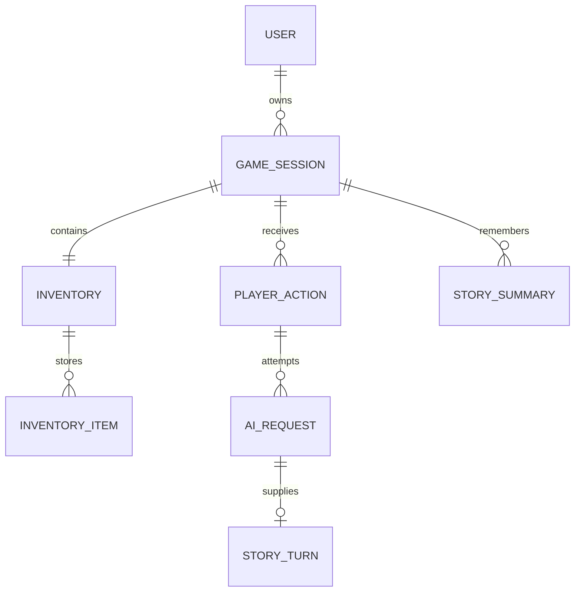

<div align="center">
  
  <h1>RPI</h1>
  <p><strong>Текстовая RPG с будущим ИИ-рассказчиком</strong></p>
  <p>Ваши решения. Новые пути. История, которая помнит пройденное.</p>
  <p><kbd>Ruby 4.0.1</kbd> · <kbd>Rails 8.1</kbd> · <kbd>SQLite</kbd> · <kbd>Прототип</kbd></p>
</div>

---

## О проекте

**RPI** — браузерная текстовая RPG, в которой игрок исследует мир и задаёт действия персонажа текстом. Проект строится вокруг идеи ИИ-рассказчика: он должен отвечать на решения игрока, развивать события и учитывать сохранённую память сюжета.

Интерфейс выполнен в молочно-кофейной палитре: здоровье и выносливость расположены сверху слева, игровая навигация — справа, а текст истории и ввод действия — на полупрозрачной нижней панели.

> **Текущий этап:** работают аккаунты, профиль и инструменты оформления; подготовлены модели хранения истории и автотесты. Экран игры пока демонстрационный: ИИ, генерация изображений и отправка команд ещё не подключены.

[Возможности](#возможности) · [Запуск](#запуск) · [Интерфейс](#интерфейс) · [Данные](#данные) · [Тесты](#тесты) · [Структура](#структура) · [Планы](#планы)

## Возможности

| Направление | Что уже есть |
| --- | --- |
| Аккаунты | Регистрация, вход, сохранение сессии между обновлениями страницы и выход с подтверждением. |
| Профиль | Изменение имени, статистика прохождений и возврат на исходный экран. Выход с подтверждением расположен сверху справа. |
| Пароли | bcrypt для хеширования, zxcvbn-ruby для оценки стойкости, обязательное подтверждение. |
| Игровые сессии | Одна активная сессия на аккаунт, завершённые прохождения и выборка последних 10 результатов. Новая игра заменяет незавершённую. |
| История и ИИ | Действия игрока, технические попытки запросов, принятые ходы и версии саммэри — отдельные модели. |
| Инвентарь | Свой набор предметов в каждой сессии; добавление, объединение в стопки и списание количества. Пока на уровне моделей. |
| Интерфейс | Главное меню, игровые индикаторы, панель истории, формы, русские сообщения ошибок. |
| UI Kit | Отдельная страница кнопок, полей, уведомлений, игровых компонентов и их состояний. |
| UI Lab | Изменение цветов, непрозрачности, размытия и масштаба текста прямо в браузере. |
| Проверки | Minitest для моделей, регистрации, авторизации и переходов между страницами. |

Основная логика проекта написана на **Ruby on Rails**. HTML/ERB и CSS отвечают за представление, небольшой JavaScript — за UI Lab и диалог выхода. Отдельный frontend-фреймворк не используется.

## Интерфейс

| Страница | Адрес | Назначение |
| --- | --- | --- |
| Главное меню | `/` | Начало игры, настройки и доступ к аккаунту. |
| Игра | `/game` | Демонстрация сцены, состояния персонажа и ввода действия. |
| Профиль | `/profile` | Имя игрока, состояние входа, выход и инструменты интерфейса. |
| Статистика | `/statistics` | До 10 последних завершённых прохождений текущего пользователя; дата, действия, финальные характеристики. |
| Регистрация | `/register` | Создание аккаунта. |
| Авторизация | `/login` | Вход в существующий аккаунт. |
| Настройки | `/settings` | Демонстрационные переключатели будущих игровых возможностей. |
| UI Kit | `/ui-kit` | Просмотр компонентов и их состояний. |

В профиле **UI Kit** и **UI Lab** находятся рядом внизу справа. UI Kit показывает компоненты, а UI Lab позволяет менять оформление. Настройки UI Lab хранятся в `localStorage` текущего браузера и не перезаписывают исходный CSS.

Стрелки в настройках, регистрации и авторизации возвращают в главное меню. Из UI Kit стрелка ведёт в профиль. Если профиль открыт из игры, сохраняется маршрут:

```text
Игра → Профиль → UI Kit
Игра ← Профиль ← UI Kit
```

Контекст `from=game` сохраняется также после входа, регистрации и изменения имени. Для обычного открытия профиля из меню параметр не нужен. На игровом экране кнопка «В меню» находится справа от профиля.

## Данные



| Модель | Ответственность |
| --- | --- |
| `User` | Аккаунт, создание/удаление прохождений, последние 10 завершённых сессий. |
| `GameSession` | Корень прохождения: состояние персонажа, статус и связанные игровые данные. |
| `Inventory` / `InventoryItem` | Контейнер сессии и предметы с описанием и количеством. |
| `PlayerAction` | Команда игрока, номер и состояние обработки. |
| `AiRequest` | Провайдер, модель, запрос/ответ, статус, ошибка и время отдельной попытки ИИ. |
| `StoryTurn` | Принятый рассказ, связанный с успешным запросом того же действия. |
| `StorySummary` | Версия краткой памяти сюжета, принадлежащая сессии. |

Связи БД образуют дерево без циклов: саммэри принадлежит только сессии, а принятый ход — только запросу ИИ. Действие и сессия хода доступны через запрос. Саммэри хранит числовую границу охваченной истории `through_position` и может существовать до первого действия. Обоснование связей и ограничения приведены в [описании модели данных](docs/data_model.md#связи-без-циклов).

`User#start_game_session!` создаёт сессию с инвентарём и удаляет прежнюю незавершённую в одной транзакции. Завершённые прохождения остаются в истории. `GameSession#submit_action!` сохраняет ввод игрока, а `PlayerAction#complete!` атомарно применяет успешный ответ и добавляет саммэри. `Inventory#add_item!` и `remove_item!` управляют предметами. `GameSession#finish!` фиксирует завершение.

Модели готовы к дальнейшему подключению, но игровой экран пока не вызывает эти методы. Методы AiRequest фиксируют попытки, а не выполняют сетевые вызовы. Подробные ограничения, ER-схема, примеры и перенос старой базы находятся в [описании модели данных](docs/data_model.md). Старая Adventure заменена GameSession миграцией с сохранением данных; миграция необратима, поэтому перед обновлением старой базы нужна резервная копия.

### Аккаунты и пароли

- Email очищается по краям, приводится к нижнему регистру и проверяется на уникальность.
- Пароль хранится как **bcrypt-хеш**, а не открытый текст и не обратимо зашифрованная строка.
- Новый пароль должен содержать от **12 символов**, занимать не более **72 байт** и иметь оценку zxcvbn-ruby не ниже **3 из 4** с учётом имени и email.
- Подтверждение нового пароля обязательно. Изменение имени не требует смены пароля.
- При успешном входе сессия обновляется; при выходе сбрасывается. Выход запрашивает подтверждение в диалоге страницы, а форма защищается CSRF-механизмом Rails.

Оценка стойкости выполняется локально в Ruby, без отправки пароля стороннему API. Подтверждение email и восстановление пароля пока не реализованы.

### Хранение и перенос

| Файл | Содержимое |
| --- | --- |
| `storage/development.sqlite3` | Пользователи и игровые данные локальной разработки. |
| `storage/test.sqlite3` | Отдельная база для автотестов. |
| `db/schema.rb` | Текущее описание структуры БД, автоматически формируемое Rails. |
| `db/migrate/` | Миграции, которые изменяют структуру базы. |

Для переноса существующих данных остановите исходное приложение, скопируйте `storage/development.sqlite3` в такую же папку нового проекта и выполните `ruby bin/rails db:prepare`. Зависимости из `vendor/bundle` устанавливайте заново на новом устройстве.

Для обычного обновления используйте миграции через `db:prepare`. `db:drop`, `db:reset` и `db:schema:load` не нужны для обновления и могут удалить существующие данные.

Файл `config/master.key` не входит в Git. Он нужен при использовании зашифрованных Rails credentials; ключи внешних API в текущем прототипе ещё не используются.

## Тесты

Подготовка тестовой базы и запуск всего набора:

```powershell
ruby bin/rails db:test:prepare
ruby bin/rails test
```

Отдельные группы:

```powershell
ruby bin/rails test test/models
ruby bin/rails test test/integration
```

Модельные тесты проверяют пароли, валидации, связи, последовательность ходов, JSON-контракт и память сюжета. Интеграционные — регистрацию, вход и выход, сессию, доступ к профилю и маршруты возврата.

Дополнительные проверки:

```powershell
bundle exec rubocop --cache false
bundle exec brakeman --no-pager
ruby bin/rails zeitwerk:check
```

Команды статического анализа не заменяют запуск автотестов.

### GitHub Actions

Конфигурация [.github/workflows/ci.yml](.github/workflows/ci.yml) запускает пять задач при push в main и для pull request: аудит Ruby-кода и gems, проверку синтаксиса локальных JavaScript-файлов, RuboCop, Rails-тесты и системные тесты. Браузерные системные тесты пока не написаны; соответствующая задача оставлена как заготовка.

CI работает на Ubuntu. В Gemfile.lock сохранены обе платформы: Windows `x64-mingw-ucrt` и Linux `x86_64-linux`. Не удаляйте Linux из lockfile при обновлении зависимостей на Windows. Добавить платформу повторно можно командой `bundle lock --add-platform x86_64-linux`; изменённый Gemfile.lock должен попасть в коммит.

Ruby-скрипты в workflow запускаются через `ruby bin/...`, поэтому Windows-строка запуска и отсутствие Unix-права исполнения не мешают CI. Importmap/npm-зависимости сейчас не используются: задача scan_js проверяет синтаксис файлов в app/assets/javascripts через Node.js 24, а не выполняет отсутствующий bin/importmap. Node.js нужен для этой проверки CI, но не для запуска Rails-сайта.

GitHub использует конфигурацию из отправленного коммита: повтор старого запуска не применит ещё не отправленные исправления. Отдельный локальный шаблон config/ci.rb не используется этим workflow.

## Структура

```text
RPI/
├── app/
│   ├── assets/          # Стили, скрипты UI Lab и диалога выхода, изображения
│   ├── controllers/     # Страницы, регистрация, вход и изменение профиля
│   ├── helpers/         # Общая стрелка возврата
│   ├── models/          # Аккаунт, сессия, инвентарь, действия, ИИ, сюжет
│   └── views/           # ERB-шаблоны экранов и UI Kit
├── config/              # Маршруты, подключение SQLite и русские локали
├── db/                  # Миграции и схема БД
├── docs/                # Концепция и описание модели данных
├── storage/             # Локальные SQLite-базы, не входят в Git
└── test/
    ├── integration/     # Проверки пользовательских сценариев
    ├── migrations/      # Перенос старой схемы на временной базе
    └── models/          # Проверки моделей и бизнес-логики
```

<details>
<summary><strong>Карта основных файлов</strong></summary>

| Файл | Назначение |
| --- | --- |
| [Gemfile](Gemfile), [Gemfile.lock](Gemfile.lock) | Зависимости проекта и закреплённые версии. |
| [user.rb](app/models/user.rb) | Аккаунт, пароли, создание/удаление сессий и история результатов. |
| [game_session.rb](app/models/game_session.rb) | Состояние прохождения, действия, версии памяти и завершение. |
| [inventory.rb](app/models/inventory.rb), [inventory_item.rb](app/models/inventory_item.rb) | Предметы сессии, добавление и списание количества. |
| [player_action.rb](app/models/player_action.rb) | Ввод игрока, создание попыток, применение ответа и отмена действия. |
| [ai_request.rb](app/models/ai_request.rb) | Статусы и данные запросов рассказчика, саммэри и изображений, повтор после ошибки. |
| [story_turn.rb](app/models/story_turn.rb), [story_summary.rb](app/models/story_summary.rb) | Принятый рассказ и отдельные версии памяти сюжета. |
| [Миграция пользователей](db/migrate/20261008170000_create_users.rb) | Таблица пользователей и уникальный индекс email. |
| [Миграция истории](db/migrate/20261016090000_create_adventures_and_story_turns.rb) | Таблицы приключений и ходов, связи, индексы и ограничения. |
| [Нормализация сессий](db/migrate/20261021120000_normalize_game_sessions.rb) | Перенос прежней структуры в новые связанные модели без потери старых ответов. |
| [Устранение циклов связей](db/migrate/20261028130000_remove_story_relationship_cycles.rb) | Удаление лишних внешних ключей с сохранением истории и границ саммэри. |
| [schema.rb](db/schema.rb) | Автоматически сформированная схема базы. |
| [application_controller.rb](app/controllers/application_controller.rb) | Текущий пользователь и разрешённый контекст возврата в игру. |
| [registrations_controller.rb](app/controllers/registrations_controller.rb) | Создание аккаунта и вход после регистрации. |
| [sessions_controller.rb](app/controllers/sessions_controller.rb) | Проверка учётных данных и управление сессией. |
| [profiles_controller.rb](app/controllers/profiles_controller.rb) | Просмотр профиля и изменение имени. |
| [application_helper.rb](app/helpers/application_helper.rb) | Общая стрелка возврата с подписью для доступности. |
| [Профиль](app/views/profiles/show.html.erb) | Поле имени, выход, диалог подтверждения и ссылки на инструменты. |
| [statistics_controller.rb](app/controllers/statistics_controller.rb), [Статистика](app/views/statistics/index.html.erb) | Закрытая для гостей сводка последних прохождений, пустое состояние и возврат в профиль. |
| [statistics_test.rb](test/integration/statistics_test.rb) | Изоляция результатов пользователей, лимит 10 записей, порядок, показатели и доступ. |
| [ui_kit_controller.rb](app/controllers/ui_kit_controller.rb), [UI Kit](app/views/ui_kit/show.html.erb) | Страница демонстрации компонентов. |
| [profile.js](app/assets/javascripts/profile.js) | Открытие, отмена и подтверждение диалога выхода. |
| [ui_lab.js](app/assets/javascripts/ui_lab.js) | Редактирование оформления и сохранение настроек в браузере. |
| [application.css](app/assets/stylesheets/application.css) | Палитра, компоненты, игровые панели и адаптивная вёрстка. |
| [routes.rb](config/routes.rb) | Адреса страниц и обработчиков форм. |
| [ru.yml](config/locales/ru.yml) | Русские сообщения валидации. |
| [user_test.rb](test/models/user_test.rb), [game_session_test.rb](test/models/game_session_test.rb) | Аккаунт, замена активной сессии, результаты, память и завершение. |
| [inventory_test.rb](test/models/inventory_test.rb), [inventory_item_test.rb](test/models/inventory_item_test.rb) | Количество, валидации, ограничения БД и изоляция предметов. |
| [player_action_test.rb](test/models/player_action_test.rb), [ai_request_test.rb](test/models/ai_request_test.rb) | Переходы состояний, повторы, ошибки и применение ответа одной транзакцией. |
| [story_turn_test.rb](test/models/story_turn_test.rb), [story_summary_test.rb](test/models/story_summary_test.rb) | Принадлежность данных, версии памяти и источники рассказа. |
| [data_relationships_test.rb](test/models/data_relationships_test.rb) | Проверка отсутствия циклов в реальных внешних ключах БД. |
| [normalize_game_sessions_test.rb](test/migrations/normalize_game_sessions_test.rb) | Перенос старой базы и откат ошибок на изолированной временной SQLite-базе. |
| [authentication_test.rb](test/integration/authentication_test.rb) | Вход, выход, сессия, доступ и редактирование профиля. |
| [navigation_test.rb](test/integration/navigation_test.rb) | Стрелки и сохранение маршрута возврата, включая регистрацию. |
| [prototype_pages_test.rb](test/integration/prototype_pages_test.rb) | Основные страницы, регистрация и повторный email. |

</details>

## Планы

- [x] Главное меню и прототип игрового экрана.
- [x] Регистрация, авторизация и профиль с сохранением данных.
- [x] UI Kit и настройка оформления через UI Lab.
- [x] Модели сессий, инвентаря, истории, саммэри, запросов ИИ и автотесты.
- [ ] Подключение сессий и ходов к игровому экрану.
- [ ] Отправка действий игрока ИИ-рассказчику и обработка JSON-ответов.
- [ ] Передача сохранённой выжимки сюжета в контекст ИИ.
- [ ] Отдельная генерация изображений сцен.
- [x] Заготовки интерфейса инвентаря и статистики с пустым состоянием.
- [ ] Подключение предметов к инвентарю и сохранение игровых настроек.
- [ ] Восстановление пароля и подтверждение email.

---

Концепция: [project_vision.md](docs/project_vision.md). Данные и бизнес-логика: [data_model.md](docs/data_model.md).
