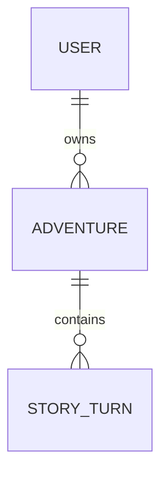

<div align="center">
  
  <h1>RPI</h1>
  <p><strong>Текстовая RPG с будущим ИИ-рассказчиком</strong></p>
  <p>Ваши решения. Новые пути. История, которая помнит пройденное.</p>
  <p><kbd>Ruby 4.0.1</kbd> · <kbd>Rails 8.1</kbd> · <kbd>SQLite</kbd> · <kbd>Прототип</kbd></p>
</div>

---

## О проекте

**RPI** — браузерная текстовая RPG, в которой игрок исследует мир и задаёт действия персонажа текстом. Проект строится вокруг идеи ИИ-рассказчика: он должен отвечать на решения игрока, развивать события и учитывать сохранённую память сюжета.

Интерфейс выполнен в молочно-кофейной палитре: здоровье и выносливость расположены сверху слева, игровая навигация — справа, а текст истории и ввод действия — на полупрозрачной нижней панели.

> **Текущий этап:** работают аккаунты, профиль и инструменты оформления; подготовлены модели хранения истории и автотесты. Экран игры пока демонстрационный: ИИ, генерация изображений и отправка команд ещё не подключены.

[Возможности](#возможности) · [Запуск](#запуск) · [Интерфейс](#интерфейс) · [Данные](#данные) · [Тесты](#тесты) · [Структура](#структура) · [Планы](#планы)

## Возможности

| Направление | Что уже есть |
| --- | --- |
| Аккаунты | Регистрация, вход, сохранение сессии между обновлениями страницы и выход с подтверждением. |
| Профиль | Изменение имени и возврат на экран, из которого открыт профиль. |
| Пароли | bcrypt для хеширования, zxcvbn-ruby для оценки стойкости, обязательное подтверждение. |
| История | Модели пользователя, приключения и хода; сохранение хода и выжимки сюжета одной транзакцией. |
| Интерфейс | Главное меню, игровые индикаторы, панель истории, формы, русские сообщения ошибок. |
| UI Kit | Отдельная страница кнопок, полей, уведомлений, игровых компонентов и их состояний. |
| UI Lab | Изменение цветов, непрозрачности, размытия и масштаба текста прямо в браузере. |
| Проверки | Minitest для моделей, регистрации, авторизации и переходов между страницами. |

Основная логика проекта написана на **Ruby on Rails**. HTML/ERB и CSS отвечают за представление, небольшой JavaScript — за UI Lab и диалог выхода. Отдельный frontend-фреймворк не используется.

## Интерфейс

| Страница | Адрес | Назначение |
| --- | --- | --- |
| Главное меню | `/` | Начало игры, настройки и доступ к аккаунту. |
| Игра | `/game` | Демонстрация сцены, состояния персонажа и ввода действия. |
| Профиль | `/profile` | Имя игрока, состояние входа, выход и инструменты интерфейса. |
| Регистрация | `/register` | Создание аккаунта. |
| Авторизация | `/login` | Вход в существующий аккаунт. |
| Настройки | `/settings` | Демонстрационные переключатели будущих игровых возможностей. |
| UI Kit | `/ui-kit` | Просмотр компонентов и их состояний. |

В профиле **UI Kit** и **UI Lab** находятся рядом внизу справа. UI Kit показывает компоненты, а UI Lab позволяет менять оформление. Настройки UI Lab хранятся в `localStorage` текущего браузера и не перезаписывают исходный CSS.

Стрелки в настройках, регистрации и авторизации возвращают в главное меню. Из UI Kit стрелка ведёт в профиль. Если профиль открыт из игры, сохраняется маршрут:

```text
Игра → Профиль → UI Kit
Игра ← Профиль ← UI Kit
```

Контекст `from=game` сохраняется также после входа, регистрации и изменения имени. Для обычного открытия профиля из меню параметр не нужен. На игровом экране кнопка «В меню» находится справа от профиля.

## Данные



| Модель | Ответственность |
| --- | --- |
| `User` | Имя, email, хеш пароля и принадлежащие пользователю приключения. |
| `Adventure` | Название, статус, здоровье, выносливость и актуальная выжимка сюжета. |
| `StoryTurn` | Номер хода, команда игрока и JSON-ответ с текстом истории и выжимкой. |

`User#start_adventure!` создаёт приключение. `Adventure#record_turn!` проверяет ответ, назначает следующий номер и сохраняет ход вместе с памятью сюжета. Ошибка откатывает транзакцию. `Adventure#finish!` завершает приключение, после чего `record_turn!` отклоняет новые ходы.

Модели готовы к дальнейшему подключению, но игровой экран пока не вызывает эти методы. Подробные ограничения, ER-схема и примеры находятся в [описании модели данных](docs/data_model.md).

### Аккаунты и пароли

- Email очищается по краям, приводится к нижнему регистру и проверяется на уникальность.
- Пароль хранится как **bcrypt-хеш**, а не открытый текст и не обратимо зашифрованная строка.
- Новый пароль должен содержать от **12 символов**, занимать не более **72 байт** и иметь оценку zxcvbn-ruby не ниже **3 из 4** с учётом имени и email.
- Подтверждение нового пароля обязательно. Изменение имени не требует смены пароля.
- При успешном входе сессия обновляется; при выходе сбрасывается. Выход запрашивает подтверждение в диалоге страницы, а форма защищается CSRF-механизмом Rails.

Оценка стойкости выполняется локально в Ruby, без отправки пароля стороннему API. Подтверждение email и восстановление пароля пока не реализованы.

### Хранение и перенос

| Файл | Содержимое |
| --- | --- |
| `storage/development.sqlite3` | Пользователи и игровые данные локальной разработки. |
| `storage/test.sqlite3` | Отдельная база для автотестов. |
| `db/schema.rb` | Текущее описание структуры БД, автоматически формируемое Rails. |
| `db/migrate/` | Миграции, которые изменяют структуру базы. |

Для переноса существующих данных остановите исходное приложение, скопируйте `storage/development.sqlite3` в такую же папку нового проекта и выполните `ruby bin/rails db:prepare`. Зависимости из `vendor/bundle` устанавливайте заново на новом устройстве.

Для обычного обновления используйте миграции через `db:prepare`. `db:drop`, `db:reset` и `db:schema:load` не нужны для обновления и могут удалить существующие данные.

Файл `config/master.key` не входит в Git. Он нужен при использовании зашифрованных Rails credentials; ключи внешних API в текущем прототипе ещё не используются.

## Тесты

Подготовка тестовой базы и запуск всего набора:

```powershell
ruby bin/rails db:test:prepare
ruby bin/rails test
```

Отдельные группы:

```powershell
ruby bin/rails test test/models
ruby bin/rails test test/integration
```

Модельные тесты проверяют пароли, валидации, связи, последовательность ходов, JSON-контракт и память сюжета. Интеграционные — регистрацию, вход и выход, сессию, доступ к профилю и маршруты возврата.

Дополнительные проверки:

```powershell
bundle exec rubocop --cache false
bundle exec brakeman --no-pager
ruby bin/rails zeitwerk:check
```

В исходных файлах контроллеров и первой миграции остаются замечания RuboCop о завершающем переводе строки. Команды статического анализа не заменяют запуск автотестов.

## Структура

```text
RPI/
├── app/
│   ├── assets/          # Стили, скрипты UI Lab и диалога выхода, изображения
│   ├── controllers/     # Страницы, регистрация, вход и изменение профиля
│   ├── helpers/         # Общая стрелка возврата
│   ├── models/          # User, Adventure, StoryTurn
│   └── views/           # ERB-шаблоны экранов и UI Kit
├── config/              # Маршруты, подключение SQLite и русские локали
├── db/                  # Миграции и схема БД
├── docs/                # Концепция и описание модели данных
├── storage/             # Локальные SQLite-базы, не входят в Git
└── test/
    ├── integration/     # Проверки пользовательских сценариев
    └── models/          # Проверки моделей и бизнес-логики
```

<details>
<summary><strong>Карта основных файлов</strong></summary>

| Файл | Назначение |
| --- | --- |
| [Gemfile](Gemfile), [Gemfile.lock](Gemfile.lock) | Зависимости проекта и закреплённые версии. |
| [user.rb](app/models/user.rb) | Валидации пользователя, bcrypt, zxcvbn-ruby, нормализация email и создание приключений. |
| [adventure.rb](app/models/adventure.rb) | Состояние приключения, транзакционное сохранение хода и завершение. |
| [story_turn.rb](app/models/story_turn.rb) | Номер хода, команда, проверка ответа и чтение текста рассказчика. |
| [Миграция пользователей](db/migrate/20261008170000_create_users.rb) | Таблица пользователей и уникальный индекс email. |
| [Миграция истории](db/migrate/20261016090000_create_adventures_and_story_turns.rb) | Таблицы приключений и ходов, связи, индексы и ограничения. |
| [schema.rb](db/schema.rb) | Автоматически сформированная схема базы. |
| [application_controller.rb](app/controllers/application_controller.rb) | Текущий пользователь и разрешённый контекст возврата в игру. |
| [registrations_controller.rb](app/controllers/registrations_controller.rb) | Создание аккаунта и вход после регистрации. |
| [sessions_controller.rb](app/controllers/sessions_controller.rb) | Проверка учётных данных и управление сессией. |
| [profiles_controller.rb](app/controllers/profiles_controller.rb) | Просмотр профиля и изменение имени. |
| [application_helper.rb](app/helpers/application_helper.rb) | Общая стрелка возврата с подписью для доступности. |
| [Профиль](app/views/profiles/show.html.erb) | Поле имени, выход, диалог подтверждения и ссылки на инструменты. |
| [ui_kit_controller.rb](app/controllers/ui_kit_controller.rb), [UI Kit](app/views/ui_kit/show.html.erb) | Страница демонстрации компонентов. |
| [profile.js](app/assets/javascripts/profile.js) | Открытие, отмена и подтверждение диалога выхода. |
| [ui_lab.js](app/assets/javascripts/ui_lab.js) | Редактирование оформления и сохранение настроек в браузере. |
| [application.css](app/assets/stylesheets/application.css) | Палитра, компоненты, игровые панели и адаптивная вёрстка. |
| [routes.rb](config/routes.rb) | Адреса страниц и обработчиков форм. |
| [ru.yml](config/locales/ru.yml) | Русские сообщения валидации. |
| [user_test.rb](test/models/user_test.rb) | Пользователь, пароли, аутентификация и владение приключениями. |
| [adventure_test.rb](test/models/adventure_test.rb) | Состояния, ход истории, память и завершение приключения. |
| [story_turn_test.rb](test/models/story_turn_test.rb) | JSON-контракт, обязательные поля и порядок ходов. |
| [authentication_test.rb](test/integration/authentication_test.rb) | Вход, выход, сессия, доступ и редактирование профиля. |
| [navigation_test.rb](test/integration/navigation_test.rb) | Стрелки и сохранение маршрута возврата, включая регистрацию. |
| [prototype_pages_test.rb](test/integration/prototype_pages_test.rb) | Основные страницы, регистрация и повторный email. |

</details>

## Планы

- [x] Главное меню и прототип игрового экрана.
- [x] Регистрация, авторизация и профиль с сохранением данных.
- [x] UI Kit и настройка оформления через UI Lab.
- [x] Модели истории, схема БД и автотесты.
- [ ] Подключение приключений и ходов к игровому экрану.
- [ ] Отправка действий игрока ИИ-рассказчику и обработка JSON-ответов.
- [ ] Передача сохранённой выжимки сюжета в контекст ИИ.
- [ ] Отдельная генерация изображений сцен.
- [ ] Рабочий инвентарь и игровые настройки.
- [ ] Восстановление пароля и подтверждение email.

---

Концепция: [project_vision.md](docs/project_vision.md). Данные и бизнес-логика: [data_model.md](docs/data_model.md).
