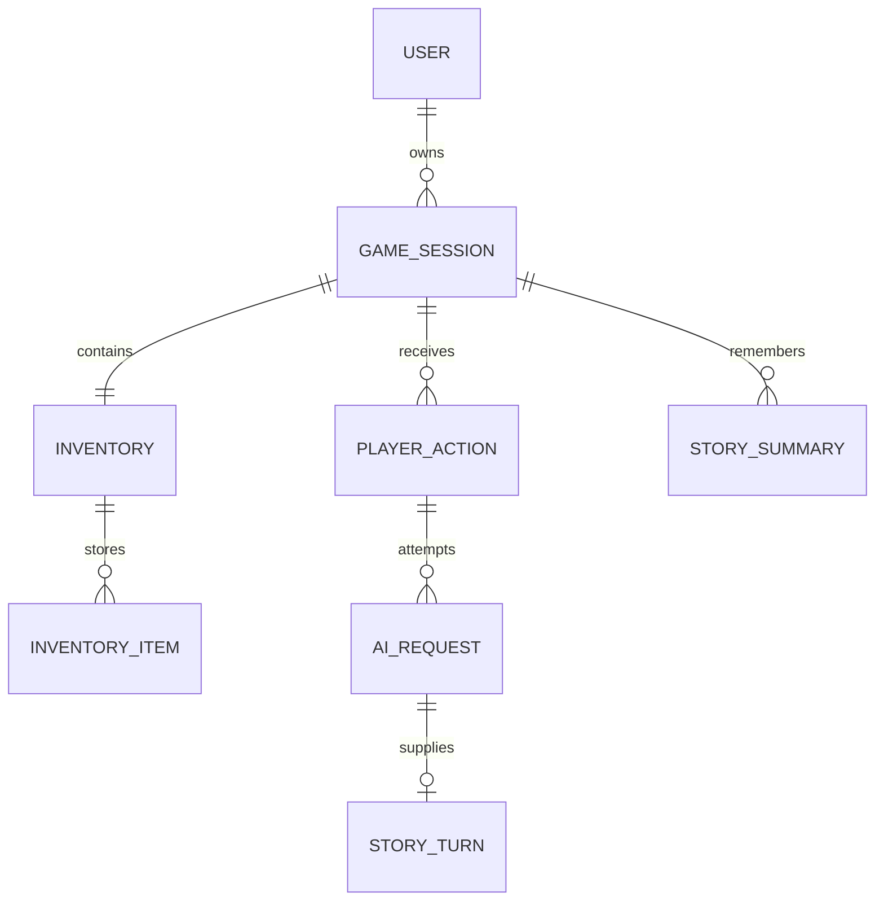

# Модель данных RPI

Корень игрового состояния — **GameSession**. Она не связана с cookie-сессией авторизации Rails: вход определяет пользователя, а GameSession хранит отдельное прохождение.

## Связи



У пользователя может быть несколько завершённых прохождений, но только одна активная сессия. Предметы, действия, запросы и память не общие для аккаунта: каждый набор принадлежит своему прохождению.

### Связи без циклов

Внешние ключи образуют дерево, в том числе если рассматривать связи без направления. У каждой дочерней сущности один непосредственный владелец:

```text
User
└── GameSession
    ├── Inventory
    │   └── InventoryItem
    ├── StorySummary
    └── PlayerAction
        └── AiRequest
            └── StoryTurn
```

Прямые внешние ключи `story_summaries.player_action_id` и `story_turns.player_action_id` удалены. Rails-ассоциации `through` и метод `PlayerAction#story_turn` читают данные через запросы и не добавляют связей в БД.

| Связь | Зачем нужна |
| --- | --- |
| GameSession → много StorySummary | Память принадлежит всему прохождению; предыстория может появиться до первого действия. Версии нумеруются в пределах сессии. |
| PlayerAction → много AiRequest | Один ввод может потребовать рассказ, изображение, саммэри и повторные попытки. |
| AiRequest → 0–1 StoryTurn | Ход сохраняет источник принятого ответа. Неуспешные запросы, изображения, саммэри и непринятые варианты не создают ход. |

Саммэри хранит `through_position`: до какой позиции включительно сжата история; `0` означает предысторию без ходов. Это числовая граница снимка памяти, а не идентификатор записи или Rails-ассоциация. При создании модель проверяет, что положительная граница соответствует завершённой истории своей сессии. Для одной границы можно хранить несколько версий. Поэтому саммэри оставлены у сессии: единственное саммэри у действия исключило бы предысторию и историю исправлений памяти.

Для запроса разрешён максимум один принятый ход: это обеспечивает уникальный индекс по `ai_request_id`. Для действия также принимается только один рассказ из всех его попыток: это проверяет `StoryTurn`, а `PlayerAction#complete!` применяет ответ под блокировкой сессии и в транзакции. После удаления прямого ключа на действие уникального индекса по действию в `story_turns` нет. Прямой SQL или методы, обходящие валидации, могут нарушить правило одного рассказа на действие, статус источника и корректность границы памяти. Для игровых операций следует использовать `submit_action!`, `complete!` и `add_summary!`.

Удаление сессии через модели удаляет её память, инвентарь и действия, затем запросы действий и их ходы по цепочке `dependent: :destroy`.

## Почему разделены сущности

| Модель | Ответственность |
| --- | --- |
| User | Аккаунт, пароль, создание/удаление сессий, выборка результатов. |
| GameSession | Название прохождения, active/completed, здоровье, выносливость, время завершения. |
| Inventory | Один контейнер предметов конкретной сессии. Создаётся автоматически. |
| InventoryItem | Локальный код предмета, название, описание, количество. |
| PlayerAction | Ввод игрока до обращения к ИИ: команда, позиция, pending/completed/cancelled. |
| AiRequest | Одна техническая попытка: назначение, провайдер, модель, тело запроса/ответа, статус, ошибка, время выполнения. |
| StoryTurn | Принятый результат рассказчика для действия, связанный с успешным AiRequest. |
| StorySummary | Версия памяти сессии с номером и числовой границей охваченной истории. |

Один ввод игрока может вызвать запрос рассказчика, генерацию изображения, сжатие памяти и повторные попытки после ошибки. Поэтому PlayerAction и AiRequest не объединены. Ответ провайдера остаётся в AiRequest, а принятый игровой текст — в StoryTurn.

Отдельный глобальный каталог Item пока не нужен: ИИ сможет создавать предметы с уникальными для прохождения описаниями. InventoryItem хранит эти данные внутри конкретного инвентаря. Если появится общий каталог типов предметов, его можно будет добавить отдельно.

## Игровая сессия

- User#start_game_session!(title:) транзакционно удаляет незавершённое прохождение и создаёт новое с пустым инвентарём.
- Если создание новой сессии не прошло валидацию, удаление старой откатывается вместе с инвентарём, ходами и памятью.
- Завершённые сессии не удаляются при начале новой. User#recent_game_sessions возвращает последние 10 по completed_at; более старые результаты остаются в БД.
- GameSession#finish! фиксирует completed_at. Незавершённое действие или pending/running запрос препятствует завершению.
- Методы добавления действий, изменения инвентаря и памяти запрещены для завершённой сессии.
- User#delete_game_session!(game_session) явно удаляет только принадлежащее пользователю прохождение и все связанные данные.

На странице /statistics уже есть заготовка сводки: до 10 завершённых сессий текущего пользователя, дата завершения, количество выполненных действий и финальные характеристики. Без завершённых сессий отображается пустое состояние. Отдельные правила победы/поражения пока не определены.

## Ограничения

| Данные | Валидации и ограничения |
| --- | --- |
| Аккаунт | Имя обязательно, до 40 символов; нормализованный уникальный email; bcrypt и zxcvbn-ruby. |
| Сессия | Название до 120 символов; целые здоровье/выносливость 0–100; завершённой сессии нужна дата завершения. |
| Инвентарь | Уникальная связь с сессией; внешние ключи. |
| Предмет | Код до 80 ASCII-символов: буквы/цифры/дефис/подчёркивание; имя до 120; описание до 2000; количество 1–1 000 000. |
| Действие | Непустая команда до 2000 символов; положительная уникальная позиция в пределах сессии. |
| Запрос ИИ | Обязательны провайдер, идентификатор модели и непустой request_payload в виде Hash. |
| Ход | Непустой narration до 20 000 символов; один ход на действие и один на запрос. Источник — успешный запрос рассказчика именно этого действия. |
| Саммэри | Непустой content до 20 000 символов, положительная уникальная версия в пределах сессии. Целая through_position ≥ 0; положительная граница должна соответствовать завершённой истории этой сессии. |

Частичные уникальные индексы обеспечивают одну активную сессию на пользователя, одно pending-действие на сессию и один pending/running запрос каждого назначения на действие. В БД также есть внешние ключи, уникальные индексы и CHECK для статусов, количества, характеристик и положительных номеров.

## Запись действия и запросов

```ruby
user = User.find(1)
game = user.start_game_session!(title: "У старых ворот")
action = game.submit_action!(command: "Осмотреть ворота")

request = action.request_ai!(
  purpose: "narration",
  provider: "example-provider",
  model_identifier: "example-model",
  payload: { "prompt" => "Продолжи историю: #{action.command}" }
)
request.start!

# Здесь будущий API-клиент выполнит сетевой вызов вне транзакции.
request.succeed!(response: { "narration" => "На камне виднеются свежие следы." })

turn = action.complete!(request: request, summary: "Герой обнаружил следы у ворот.")
game.summary # => актуальный content из StorySummary
```

В примерах нет настоящего сетевого вызова. request_ai! лишь создаёт запись; start!, succeed! и fail! фиксируют состояние попытки. Эти методы не отправляют запрос внешнему сервису.

### Контракт ответов

| purpose | Успешный response_payload |
| --- | --- |
| narration | Hash с непустой строкой narration. |
| summary | Hash с непустой строкой summary. |
| image | Hash с непустой строкой image_url. Модель не скачивает и не проверяет доступность изображения. |

Полезная строка ограничена 20 000 символов, дополнительные ключи сохраняются. Сырой JSON сначала нужно разобрать: методы принимают Hash, а не строку JSON.

Не помещайте API-ключи и заголовки авторизации в request_payload. Учётные данные будущего клиента должны находиться в окружении или Rails credentials.

### Ошибки и повторы

```ruby
request.fail!(message: "Провайдер не ответил вовремя") # из pending или running
retry_request = request.retry!                       # новая запись pending
retry_request.start!
retry_request.succeed!(response: { "narration" => "Продолжение истории" })
```

Этот пример относится к отдельной ещё не завершённой попытке, а не к уже succeeded запросу из предыдущего примера. Старый failed запрос, его ошибка и timestamps сохраняются. Терминальную попытку нельзя запустить или завершить повторно.

Ошибочный формат ответа оставляет попытку running в базе: вызывающий код может отметить её failed и затем повторить. Cancelled-действие не принимает запросы. После применения рассказа можно создать отдельные запросы image/summary, но новый narration для этого действия запрещён.

### Применение результата

PlayerAction#complete! в одной транзакции создаёт StoryTurn, меняет статус действия на completed и добавляет StorySummary. Неверное саммэри откатывает и уже вставленный ход, и статус. Успешный технический запрос остаётся в БД, чтобы корректный результат можно было применить повторно.

Повтор complete! с тем же запросом возвращает ранее созданный ход; переданное новое саммэри при этом не применяется. Другой запрос не может заменить уже принятый ход. Запрос чужого действия, незавершённая попытка и ответ генератора изображения отклоняются.

Пока pending-действие не завершено или не отменено через cancel!, следующее действие не создаётся. Для отмены сначала нужно завершить либо отметить failed все его активные запросы. Позиции отменённых действий сохраняются.

## Инвентарь: добавление и удаление

```ruby
inventory = game.inventory
inventory.add_item!(code: "health_potion", name: "Зелье здоровья", quantity: 3)
inventory.add_item!(code: "health_potion", name: "Зелье здоровья", quantity: 2)
inventory.remove_item!(code: "health_potion", quantity: 1) # осталось 4
inventory.remove_item!(code: "health_potion", quantity: 4) # запись удалена
```

Код приводится к нижнему регистру и очищается по краям. Повторное добавление кода увеличивает количество, не переписывая имя и описание существующего предмета. Отрицательные, нулевые, дробные и строковые количества отклоняются. При недостатке предметов операция целиком отменяется; чужой инвентарь не затрагивается.

## Версии памяти

```ruby
game.add_summary!(content: "Предыстория") # до первого действия, through_position = 0
# После завершённого действия:
game.add_summary!(content: "Уточнённая память", through_position: action.position)
# Без through_position автоматически берётся последняя завершённая позиция:
game.add_summary!(content: "Ещё одна версия памяти")
game.latest_summary
game.remove_summary!(game.latest_summary) # вернуть предыдущую версию
```

Предыстория из первого вызова должна добавляться до ходов, а не после них. Версия увеличивается внутри сессии. Новое саммэри не затирает прежнее; допускается уточнение для той же границы истории, но нельзя смещать память к более ранней позиции. Pending- и cancelled-действия не могут задавать положительную границу. Удалять через remove_summary! можно только последнюю версию своей сессии. После её удаления актуальной становится предыдущая; номер удалённой последней версии может использоваться снова.

GameSession#summary теперь вычисляемый метод, а не дублирующая колонка. История целиком находится в StoryTurn/PlayerAction; саммэри — её компактная память для будущего промпта.

## Миграция старых данных

Миграция `20261021120000_normalize_game_sessions.rb`:

1. Переименовывает adventures в game_sessions, сохраняя идентификаторы, владельца и характеристики.
2. Создаёт инвентарь каждой старой сессии.
3. Разделяет прежние command/response на PlayerAction, AiRequest и StoryTurn; номера и идентификаторы старых ходов сохраняются.
4. Переносит каждое summary из ответа и последнюю отдельно сохранённую память в StorySummary.
5. Убирает старую колонку summary и заменяет структуру story_turns после успешного переноса.

У импортированных запросов provider=legacy, model_identifier=prototype: это отметка происхождения, а не свидетельство реального вызова ИИ. Полный старый JSON сохраняется в response_payload, включая дополнительные ключи. Для завершённых сессий completed_at берётся из прежнего updated_at.

Если у одного пользователя оказалось несколько старых active-прохождений, миграция останавливается без выбора и удаления данных: нужно сначала определить одно активное. Некорректный JSON также прерывает перенос; миграционная транзакция восстанавливает исходную структуру.

Перед переносом старой базы сделайте её резервную копию при остановленном приложении. Обычная команда обновления:

```powershell
ruby bin/rails db:prepare
ruby bin/rails db:test:prepare
ruby bin/rails test
```

Откат этой миграции через db:rollback намеренно запрещён: в новой схеме больше данных, чем в старой. Для возврата нужны прежняя версия приложения и резервная копия базы.

### Устранение циклов связей

Следующая миграция `20261028130000_remove_story_relationship_cycles.rb` переводит нормализованную схему в дерево:

1. Проверяет совпадение старых путей принадлежности хода и саммэри. При противоречивых данных останавливается до изменения схемы.
2. Переносит позицию охваченного действия в `story_summaries.through_position`; отсутствие действия превращается в `0`.
3. Удаляет `story_summaries.player_action_id` и `story_turns.player_action_id` с их внешними ключами и индексами.
4. Сохраняет идентификаторы, содержимое, версии и timestamps записей. Действие хода определяется через сохранённый `ai_request_id`.

Эта миграция имеет `down`: ссылка хода восстанавливается из запроса, ссылка саммэри — по сессии и сохранённой позиции. Если соответствующее действие уже удалено, необязательная ссылка саммэри останется пустой. Перед откатом нужно вернуть совместимую версию моделей; более ранняя миграция нормализации по-прежнему необратима.

## Тесты и границы

Модели проверяются в `test/models/`, перенос — в `test/migrations/`. `DataRelationshipsTest` обходит реальные внешние ключи и проверяет, что все игровые таблицы образуют одно дерево без циклов. Тест миграции запускает отдельный Rails-процесс с временной SQLite-базой, создаёт старую схему, проверяет сохранность данных, остановку при противоречивых связях и обратный перенос. Рабочая база пользователя не используется.

Проверяются транзакции, уникальность, изоляция сессий, смена прохождения, статистика, предметы, статусы попыток, повторное применение ответов и версии памяти. Модельные операции блокируют изменяемые корневые записи; сетевые вызовы внутри этих транзакций выполнять нельзя. Для SQLite тесты выполняются последовательно.

Игровой экран пока не подключён к методам прохождения и инвентарю. API-клиент, фоновые задачи и генерация изображений не реализованы. Статистика читает уже сохранённые завершённые сессии, но не создаёт их и не определяет исход игры.
