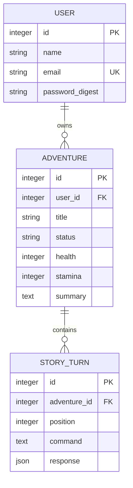

# Модель данных RPI

На скриншоте задания перечислены требования к структуре, но не задан конкретный список сущностей. Для текущего направления игры выбраны пользователь, приключение и ход истории. Инвентарь и генерация изображений будут отдельным этапом.



Все таблицы имеют created_at/updated_at. Email приводится к нижнему регистру и очищается по краям; уникальность обеспечивается моделью и индексом. User имеет has_secure_password, bcrypt и проверку zxcvbn-ruby. Смена имени не требует повторного ввода пароля. При назначении нового пароля подтверждение обязательно.

Adventure принадлежит пользователю. Название обязательно, до 120 символов. Здоровье/выносливость: целые 0–100, по умолчанию 100. Статус active/completed. Выжимка до 20 000 символов. Диапазоны и статус дополнительно ограничены CHECK в БД.

StoryTurn принадлежит приключению. Команда обязательна, до 2000 символов. Позиция положительна и уникальна в пределах приключения (составной индекс). Ответ должен быть JSON-объектом с непустыми строками narration и summary, каждая до 20 000 символов. Дополнительные ключи разрешены для будущего расширения API. Метод narration возвращает текст рассказчика.

```ruby
adventure = user.start_adventure!(title: "У старых ворот")
turn = adventure.record_turn!(
  command: "Осмотреть ворота",
  response: { "narration" => "Вы замечаете следы…", "summary" => "Герой обнаружил следы у ворот" }
)
adventure.finish!
```

record_turn! блокирует приключение, определяет следующий номер, сохраняет ход и заменяет summary в одной транзакции. Ошибка валидации откатывает обе записи. Завершённое приключение не принимает новые ходы через этот метод. Данные для модели предполагаются уже разобранным JSON (Hash со строковыми ключами); сетевые запросы внутри транзакции не выполняются. Игровой контроллер пока не вызывает эти методы.

Удаление пользователя удаляет его приключения и ходы через dependent: :destroy. Внешние ключи защищают от осиротевших записей. Для обычного удаления следует использовать destroy!, а не delete_all.

В трёх файлах `test/models` проверки разделены на контексты идентификации/пароля/владения, валидаций/транзакций/жизненного цикла, JSON-контракта/порядка. Стандартный Rails Minitest использует setup и test вместо RSpec context.
