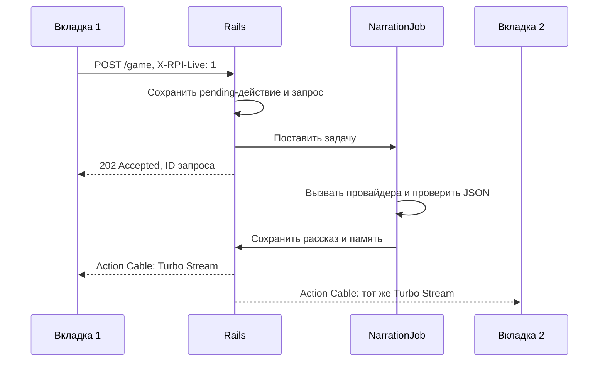

# Живые обновления: Action Cable, Turbo Streams и Turbo Frames

## Что реализовано

Вошедший игрок отправляет команду и сразу получает подтверждение приёма. Ответ рассказчика готовится отдельно, сохраняется в БД и приходит во все открытые игровые вкладки этого аккаунта через WebSocket. Обновляется область истории, а не вся страница. Это работает с Polza и с бесплатной заглушкой без API-ключа.



Отправка команды остаётся HTTP-запросом. **Доставка результата — серверный push через Action Cable**, а не ожидание готового сюжета внутри ответа на POST. Turbo Streams заменяет содержимое `#live-state`, добавляя актуальную сохранённую историю и состояние обработки. На каждом рассказе стабильный DOM ID действия: повторная доставка снимка не создаёт второй рассказ. Клиент не принимает снимки с прежней/более старой ревизией. Постепенная печать остаётся эффектом браузера после получения готового рассказа; это не потоковая генерация токенов модели.

Turbo Drive отключён через `data-turbo=false`, поскольку существующие музыка, меню и формы рассчитаны на обычный жизненный цикл страницы. Turbo Streams и WebSocket-подписка продолжают работать. Гость использует прежний бесплатный HTTP-сценарий без сохранений и подписки. Обычная HTML-отправка без JavaScript и JSON без live-заголовка сохраняют синхронный совместимый путь.

## Где искать код

| Файл | Назначение |
| --- | --- |
| `app/channels/application_cable/connection.rb` | Проверяет пользователя по Rails cookie-сессии; отвергает гостя/удалённый аккаунт. |
| `app/channels/game_channel.rb` | Проверяет подписку и выбирает приватный поток по пользователю соединения, а не по переданному ID. |
| `app/jobs/narration_job.rb` | Выполняет запрос рассказчика в фоне. |
| `app/services/storytelling/narrator.rb` | Готовит записи, ставит задачу, захватывает запрос под блокировкой, вызывает провайдера, принимает результат или отменяет действие. |
| `app/services/storytelling/live_updates.rb` | Рассылает Turbo Streams и восстанавливает состояние прерванной обработки. Ошибка рассылки не отменяет уже сохранённый ход. |
| `app/views/game/_live_state.html.erb` | Серверный HTML истории, pending/error-состояния и идентификаторов. Тексты экранируются ERB. |
| `app/assets/javascripts/live_game.js` | Отправка, статусы, рендер Streams, печать, черновик и синхронизация после переподключения. |
| `app/views/game/_inventory_contents.html.erb` | Содержимое ленивого Turbo Frame инвентаря. |

Приватный поток не имеет подписанного браузерного токена, который можно было бы повторно использовать в стандартном `Turbo::StreamsChannel`. Клиент получает только подписанное имя `game_ui`, а сервер сам определяет настоящий поток. Подмена `user_id` не даёт подписку на чужую историю. При входе/выходе аккаунта прежние Cable-соединения пользователя отключаются; другие его устройства могут кратко переподключиться. CSRF-защита форм и проверка Origin WebSocket остаются включены в production.

## Turbo Frames: инвентарь

При открытии рюкзака ленивый `turbo-frame#inventory_contents` загружает `GET /game/inventory`. Возвращается только содержимое инвентаря текущего пользователя. Повторное открытие обновляет Frame. Остальная страница не перезагружается. Это отдельная HTTP-загрузка фрагмента; живой push истории обеспечивают именно Cable и Streams.

## Запуск на своём ПК

Команды вводятся из корня проекта (`D:\RPI`). Redis, отдельный worker и платный API для демонстрации не нужны.

```powershell
cd D:\RPI
bundle install
ruby bin/rails db:prepare
ruby bin/rails server
```

Для production-демонстрации используйте прежний скрипт:

```powershell
.\script\share.ps1
# В другом окне:
.\script\share.ps1 -Mode tunnel -Provider pinggy
```

Чтобы использовать Polza, до запуска первого процесса задайте `POLZA_API_KEY` по [инструкции](polza_setup.md). Перезапустите ранее работающий сервер: новые каналы, job и JavaScript не загрузятся в старый процесс. `share.ps1` заново собирает assets. Не смешивайте адреса localhost и туннеля при проверке аккаунта: у них разные cookies.

## Как показать преподавателю

1. Войти в аккаунт и открыть `/game` в двух вкладках одного браузера. Для двух разных устройств войти в один аккаунт отдельно на каждом.
2. В DevTools → Network → WS найти `/cable`. Вкладка Messages показывает Action Cable/Turbo Stream сообщения.
3. Отправить команду в первой вкладке. POST отвечает **202**, появляется ожидание; когда работа закончится, рассказ появится в обеих вкладках.
4. Убедиться, что во второй вкладке не было нового запроса типа Document. История меняется через WebSocket. При отключённом ключе та же цепочка работает с заглушкой.
5. Открыть рюкзак: запрос `/game/inventory` обновит Turbo Frame без перезагрузки всей страницы.
6. Отключить сеть на время ответа и затем восстановить. Вкладка переподключится и подтянет пропущенный результат из БД, не вызывая нейросеть снова.

Короткий ответ заглушки может прийти почти сразу. Для демонстрации не добавлена искусственная задержка. Наличие WS-сообщения с готовым рассказом и изменение второй вкладки показывает механизм независимо от скорости.

## Ошибки, восстановление и ограничения

- Повторная команда во время pending-действия получает 409. Повторная доставка одной фоновой задачи не вызывает API повторно: запрос атомарно переводится из pending в running.
- Ошибка провайдера завершает запрос как failed, отменяет действие и присылает безопасное сообщение. Принятые раньше ходы остаются. В поле можно восстановить неудачную команду для ручного повтора; автоматических платных повторов нет.
- При подключении/переподключении и раз в 15 секунд браузер сверяет состояние через `/game/state`. Это страховка от потерянного сообщения, а не основной транспорт результата. Если сеть или туннель не пропускают WebSocket, сверка даст отложенное обновление; для подтверждения майлстоуна проверяйте именно WS.
- **Текущая конфигурация рассчитана на один процесс Puma.** Active Job `async` выполняет задачи в потоках, Action Cable `async` рассылает внутри того же процесса. Нельзя отдельно запускать jobs через `rails runner` или несколько Puma workers и ожидать общей рассылки. Для нескольких процессов нужны общий Cable-адаптер и постоянная очередь (например Solid Cable + Solid Queue).
- Очередь хранится в памяти процесса. При аварийном завершении задачи могут потеряться. После трёх минут незавершённые запросы помечаются ошибкой при следующей сверке состояния. Автоматического повторного обращения к платному API не происходит. Если ответ уже сохранён как succeeded, но процесс остановился до принятия хода, сверка завершит ход из сохранённого ответа.
- Сохранённая история находится в SQLite и переживает перезапуск. Доставка WebSocket не является журналом хранения; источником истины остаётся БД.
- Завершение/рестарт игры также уведомляет другие вкладки. При отсутствии активной игры предлагается перейти в главное меню. Снимок содержит сохранённые HP/STA, поэтому при смене сессии индикаторы также обновляются. Статистика и изображения не получили отдельную живую рассылку в этом майлстоуне.

## Автотесты и CI

Проверено 13.11.2026: серверный набор — 173 теста, 2265 проверок; браузерный — 4 теста, 36 проверок (включая seed 17092 из упавшего CI). Ошибок и пропусков нет. RuboCop (84 файла) и Brakeman проходят. Платный API в проверках не вызывается.

```powershell
ruby bin/rails test
ruby bin/rails test:system
```

Запускать последовательно: процессы используют одну тестовую SQLite. Для system tests нужен Chrome, а Selenium при первом запуске может скачать ChromeDriver (нужен интернет). В CI задачи `test` и `system-test` работают на разных runner-машинах и не мешают друг другу. Ключ Polza в тестах не используется.

- `test/channels/connection_test.rb`: вход по cookie-сессии, отказ гостю и удалённому пользователю.
- `test/channels/game_channel_test.rb`: разрешённый приватный поток, подмена ID, неверная/чужая подписанная строка.
- `test/integration/live_game_test.rb`: 202 и очередь, сохранение одного хода, broadcast в формате Turbo Stream, дубликат задачи, 409, восстановление состояния, изоляция пользователей, Frame инвентаря, ошибка API и повтор, потерянная задача, рестарт до выполнения, сохранённый ответ после сбоя, отказ постановки задачи.
- `test/system/live_game_test.rb`: настоящий Chrome, две вкладки и WebSocket. Проверяются доставка рассказа без навигации (метка документа сохраняется), получение WS-сообщения второй вкладкой, восстановление пропущенного ответа и ленивый Frame инвентаря. Есть отдельная проверка реального async-worker; в остальных сценариях тестовая очередь выполняется управляемо, чтобы не зависеть от скорости API.

Проверка WebSocket ждёт именно сообщения с готовым рассказом, а не проверяет последнее полученное сообщение: асинхронное уведомление о начале обработки может прийти позже результата. Наличие рассказа в DOM проверяется отдельно, поэтому восстановление через GET не может подменить проверку доставки по WebSocket.

## Музыка

Музыка на игровом экране синтезируется самим браузером через Web Audio API: синусоидальные осцилляторы создают ноты, последовательность четырёх аккордов и мелодию. Аудиофайлы и внешние сервисы не загружаются. Громкость плавно меняется через GainNode. Настройки включения и громкости хранятся в localStorage этого браузера, по умолчанию музыка включена с громкостью 35%.

Браузер может потребовать первый клик/нажатие для запуска звука. В скрытой вкладке контекст приостанавливается, при уходе со страницы закрывается. Поэтому обновление истории через Streams не перезапускает музыку: документ и его аудиоконтекст остаются прежними. На главном меню отдельная музыка сейчас не запускается. Это локальная композиция CC0; её настройки не синхронизируются через сервер между устройствами.
